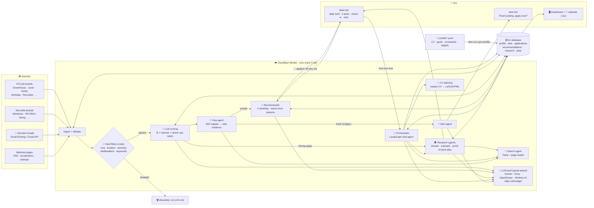
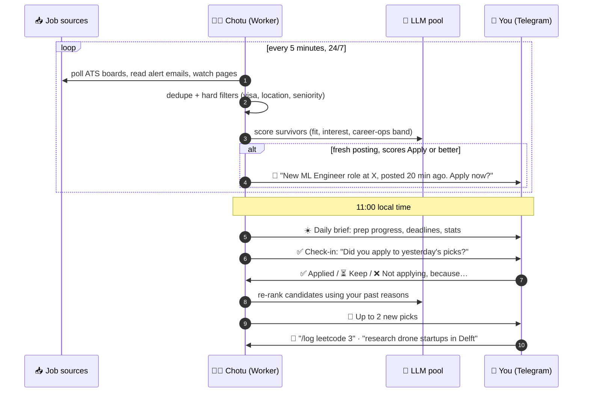

# 🧑‍🍳 Chotu: your 24/7 job-search helper

## 🌍 Why this exists

Finding an internship or a job in Europe as an international student is hard. 🎓✈️
Visa sponsorship, language requirements and huge numbers of applicants all count against you.

Here is what worked for me, every time I applied:

- ⚡ **Apply first.** Get in as soon as possible after a posting goes live.
- ✍️ **Write personalised cover letters** in your own style and your own words.
- 📄 **Tailor your CV** to the job description so the right parts of your experience stand out.
- 🎯 **Apply to roles that actually match your profile**, not to everything.
- 🔥 **Lead with curiosity and passion.** Go to startups with a problem you can solve and the value you can add.

All of that works, but it takes hours every day. **The goal of this repo is to automate it.** 🤖

## 🙋 Who is "Chotu"?

Back home in India, *chotu* (छोटू, "little one") is what people call the young helper at a restaurant or a chai stall.
Chotu runs around all day, knows where everything is, and makes sure things get done. 🍵

LLMs and agents can now be that helper for your job search, **24/7**. Every day Chotu sends you a short list of
**high-quality job postings on Telegram** 📱, and it keeps you **on track and accountable** for your interview preparation. 💪

## ✨ What Chotu does, in plain words

| | |
|---|---|
| 👀 **Watches** | job boards, company career pages, your job-alert inbox, PhD portals and accelerators |
| 🛂 **Filters** | by visa sponsorship, location, seniority and your dealbreakers (free rules, no AI needed) |
| 🧮 **Scores** | each posting on *fit* (am I a strong applicant?) and *interest* (do I want this?) |
| 🚨 **Alerts** | within minutes when a fresh, high-scoring posting appears, so you can apply first |
| 🎁 **Recommends** | exactly **2 picks a day**, and learns from why you applied or skipped |
| 🕵️ **Researches** | small companies and drafts an outreach email plus a *proof-of-work idea* you can pitch |
| ✍️ **Writes like you** | outreach and cover letters use your own writing samples as a style reference |
| 📄 **Tailors** | your CV from a master CV. It only rewords and reorders, it never invents numbers |
| 📚 **Keeps you honest** | runs a daily check-in ("did you apply?") and a prep tracker (LeetCode, books, courses) |
| 💬 **Chats** | ask *"how many applications did I send last week?"* or *"research CV startups in Berlin"* |

It runs on **Cloudflare's free tier** plus **free LLM tiers** (Gemini, Groq, OpenRouter, Workers AI), so it costs nothing to keep running. 💸

## 🗺️ How it works

### ⏰ A day with Chotu

## 🚀 Quick start

1. 🍴 Fork or clone this repo, then run `npm install`.
2. 📝 Replace the example profile in `profile/` with your own: `cv.yaml`, `goals.md`, `constraints.yaml`, `targets.yaml`.
3. 🔑 Get free keys: Gemini, a Telegram bot from @BotFather, and optionally Groq, OpenRouter and Tavily.
4. ☁️ Create a D1 database and deploy with `npx wrangler deploy`.
5. 📱 Connect Telegram, send `/start`, and Chotu starts working.

👉 Full step-by-step guide: **[docs/SETUP.md](docs/SETUP.md)** · How the code works: **[docs/LEARN.md](docs/LEARN.md)**

## 🔐 Privacy: keep *your* details private

This public repo contains **no personal data**. The profile files describe a made-up example person ("Alex Example").
When you set up your own copy:

- 🙈 **Secrets never go in git.** API keys and tokens go in `.dev.vars` (git-ignored) or `npx wrangler secret put`.
- 🗂️ `profile/contacts.csv` (LinkedIn export) and `profile/writing/*` (your writing samples) are git-ignored.
- 📄 Your real `cv.yaml`, `goals.md` and `constraints.yaml` contain your name, contact details and visa situation.
  Keep them in a **private** fork, or stop git tracking your local edits with
  `git update-index --skip-worktree profile/cv.yaml profile/goals.md profile/constraints.yaml`.
- 🌐 `wrangler.jsonc` holds your D1 `database_id` and Worker URL. They aren't secret, but they identify your deployment.
- 🔒 The dashboard and API need your `API_TOKEN`, and the Telegram bot only answers your own `TELEGRAM_CHAT_ID`.

## 🙏 Credits

- Scoring rubric ported from [career-ops](https://github.com/career-ops-hq/career-ops).
- Visa sponsor data from the Dutch IND public register of recognised sponsors.

## 📜 License

MIT, see [LICENSE](LICENSE). Good luck out there, and apply first! 🍀
